

  

<h1 align="center">EMONI LoRaWAN device and fleet platform</h1>

  <em>I built a battery-powered LoRaWAN meter reader, and the platform that keeps a fleet of them healthy: from the uplink in a basement to a fix rolled out over the air, with hardware and AI in the loop.</em>

  
  
  
  
  
  
  
  

> This repository documents what I built and how I work, with screenshots of the real system, diagrams drawn in LaTeX, and a video. Source code, schematics, part numbers, payload formats and customer data stay private. Facts and drawings of the device come only from EMONI's public documents ([emoni.cloud/downloads](https://emoni.cloud/downloads/)).

  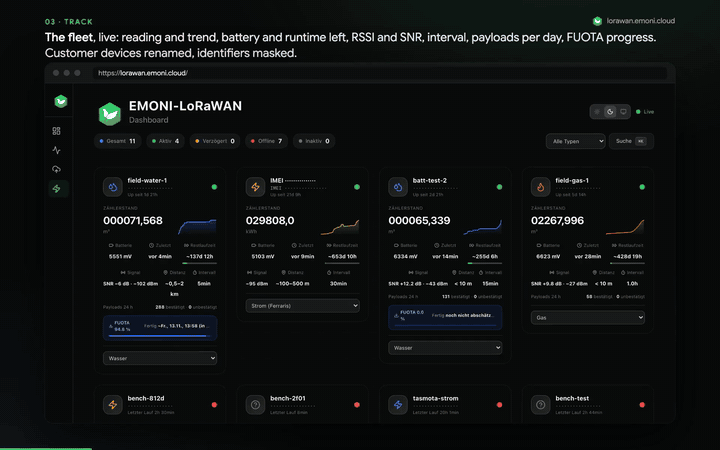

  <b><a href="media/emoni-lorawan-showcase.mp4">Watch the full walkthrough</a></b> · 5 min · MP4 · 1920 × 1200

---

## The device

**EMONI** is a retrofit meter reader for gas, water and electricity meters, made by ISIS IC. **I designed and built its LoRaWAN device**: the hardware, the firmware, the on-device recognition, the LoRaWAN behaviour and the low-power design. It sits over the counter of an existing meter, photographs the digits, recognises them on the device and sends the absolute reading over LoRaWAN, on four AA cells for years.

  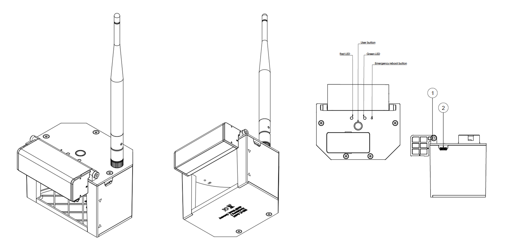

Drawings from the public EMONI datasheet.

  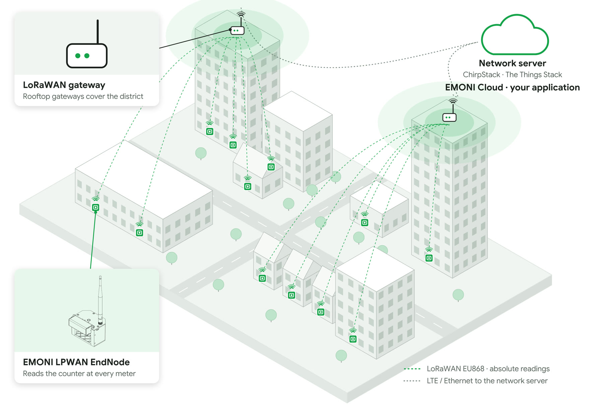

Devices in cellars and meter shafts are hard to diagnose remotely. A reading arrives late, and nobody knows whether the radio, the gateway, the network server or the firmware caused it. A battery drains faster than the budget because of a few microamps somewhere. A fix has to reach the device over a link that carries a few dozen bytes per downlink. So I built **a system around the device**: it tracks every device, gives me the tools to debug it, and lets me fix it remotely and verify the fix.

## What I built

| | |
|---|---|
| 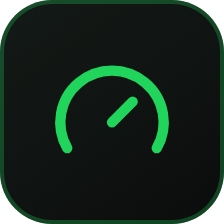 **The device** | hardware, firmware, on-device digit recognition, LoRaWAN join, retry and rejoin logic, deep sleep, calibration over local Wi-Fi, FUOTA with rollback |
|  **A fleet dashboard** | lorawan.emoni.cloud: ingests every uplink from The Things Stack, ChirpStack, generic LoRaWAN and NB-IoT webhooks, and shows each device live: reading, battery and runtime left, signal, link health, consumption, anomalies |
| 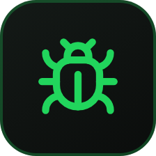 **Debugging tools** | a failure log that explains every late uplink, link health per gateway, a payload explorer, power tests with waveforms, connectivity tests that break the network on purpose, FUOTA tracking |
| 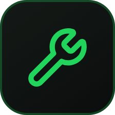 **Remote fixes** | downlinks for interval and re-baselining, automatic re-baselining of implausible jumps, firmware rollouts over the air, all logged and confirmed |
|  **A remote lab** | a bench host with a power profiler, console logging, flashing and test runners, reachable from anywhere over Tailscale, pushing every result to the dashboard |
|  **AI in the loop** | an MCP server with 26 tools over the whole fleet, and a debugger built into the dashboard that runs an AI agent next to the data, the firmware source and its history |

  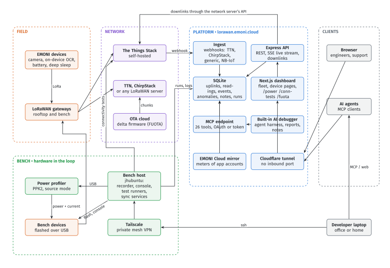

---

## In pictures

<table>
  <tr>
    <td width="50%"><a href="tracking/README.md">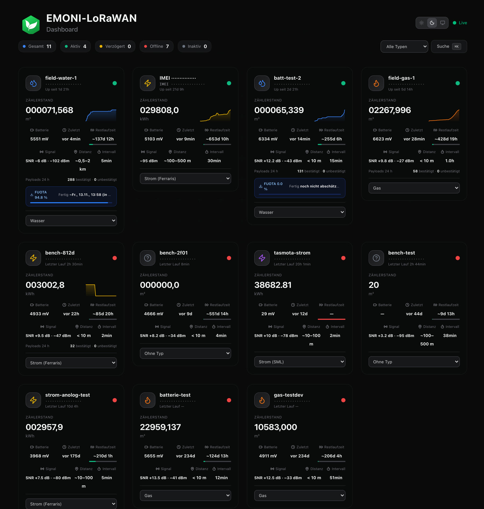</a> <b>Track</b> · every device live: reading, battery and runtime left, signal, payloads, FUOTA progress</td>
    <td width="50%"><a href="tracking/README.md">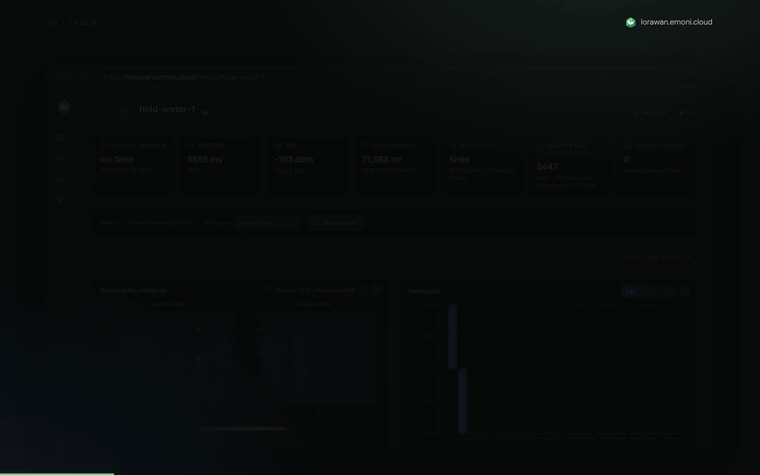</a> <b>Track</b> · one device on one page, from consumption heatmap to payload explorer</td>
  </tr>
  <tr>
    <td><a href="debugging/README.md#failure-log">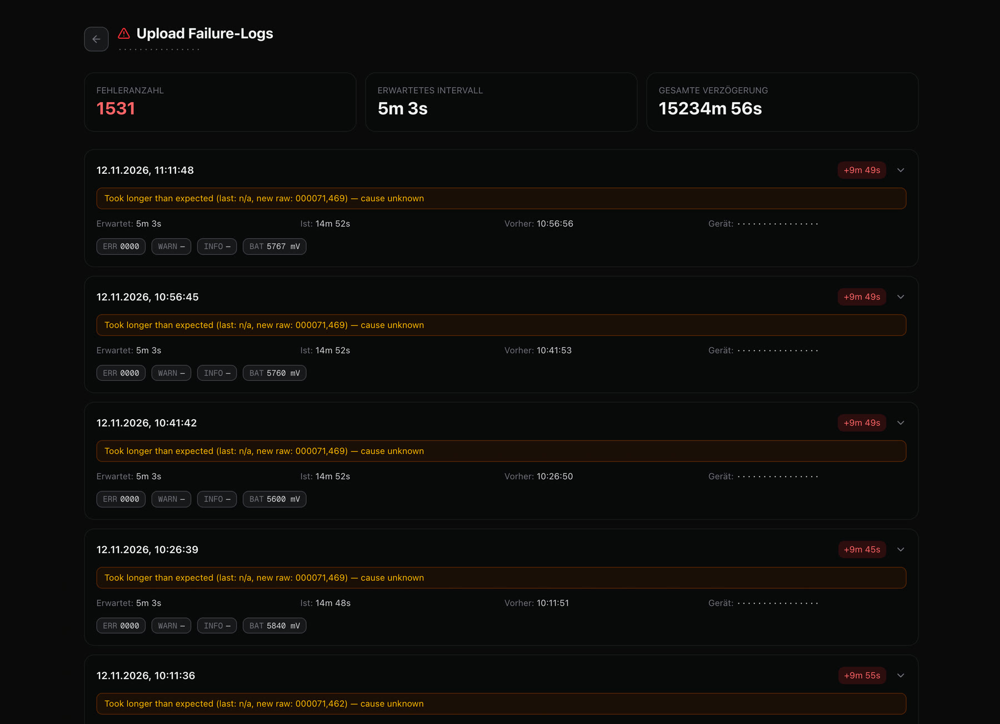</a> <b>Debug</b> · every late uplink with its cause, worked out from the data</td>
    <td><a href="debugging/README.md#link-health">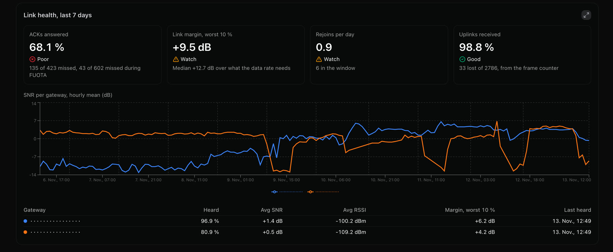</a> <b>Debug</b> · link health: ACKs, link margin, rejoins, delivery, SNR per gateway</td>
  </tr>
  <tr>
    <td> <b>Debug</b> · connectivity tests: the network changed under a live device on purpose</td>
    <td><a href="debugging/README.md#power-tests">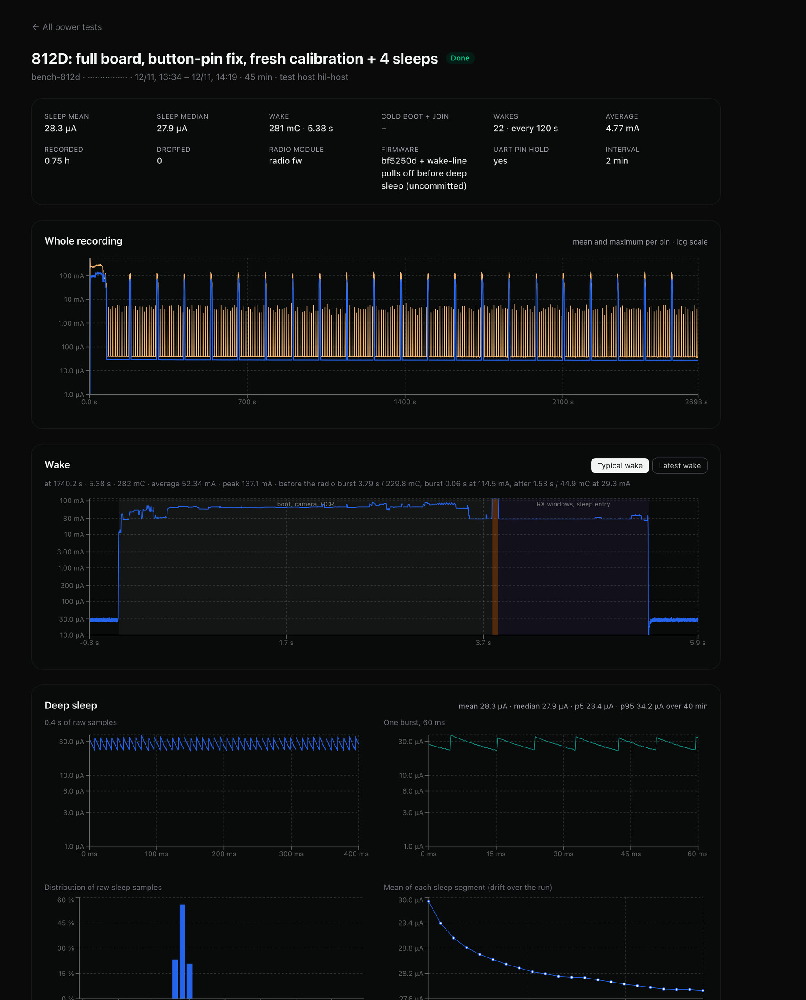</a> <b>Debug</b> · power tests from the remote lab: sleep floor, every wake, battery life</td>
  </tr>
  <tr>
    <td> <b>Remote lab</b> · flash, power, measure and control a bench device from anywhere</td>
    <td> <b>AI in the loop</b> · an agent driving the bench over SSH, condensed from a real session</td>
  </tr>
  <tr>
    <td> <b>Case study</b> · deep sleep 1840 → 28 µA in three days, every fix in firmware</td>
    <td><a href="fixing/README.md#firmware-over-the-air">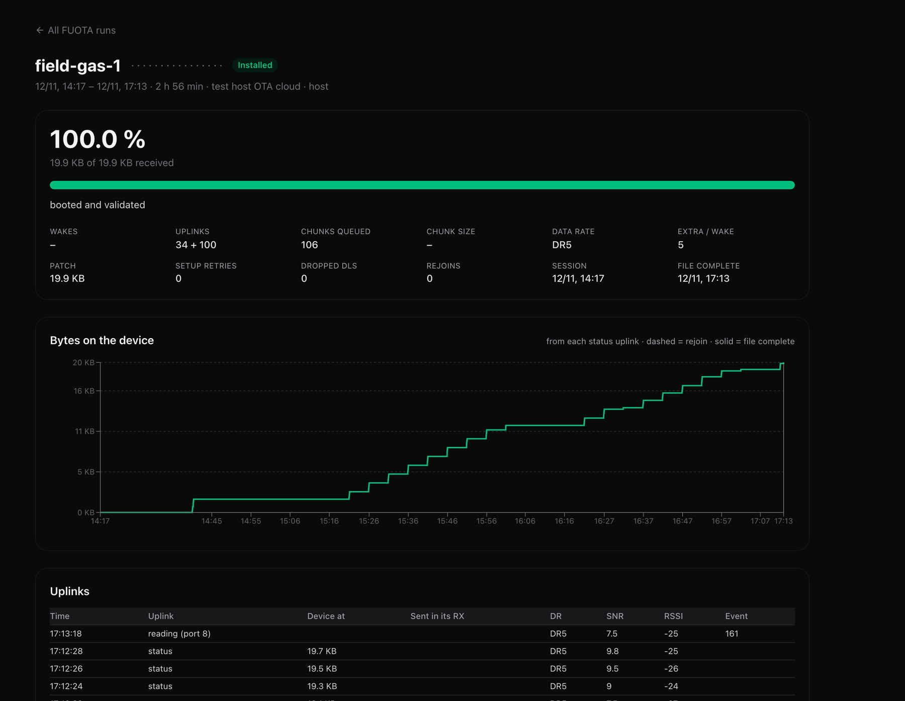</a> <b>Fix</b> · a firmware update over LoRaWAN, chunk by chunk, verified on the device</td>
  </tr>
</table>

## Diagrams, in LaTeX

<table>
  <tr>
    <td width="33%" align="center"><a href="device/README.md#one-wake-up">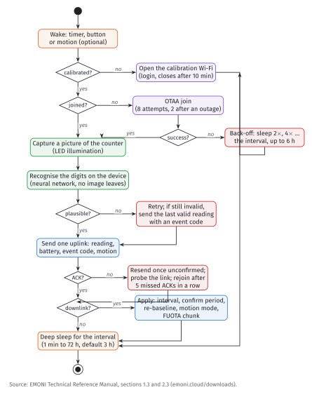</a> Activity · one wake-up of the device</td>
    <td width="34%" align="center"><a href="platform/README.md#how-an-uplink-becomes-a-live-chart">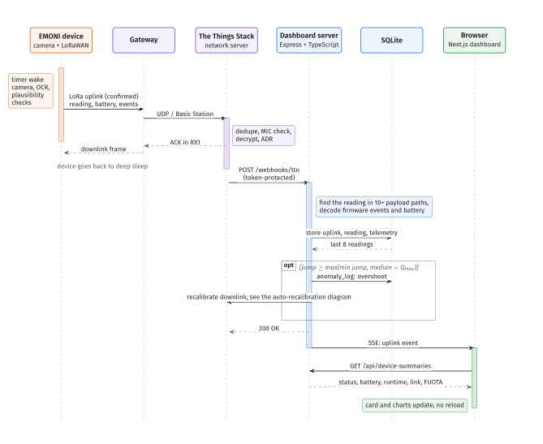</a> Sequence · an uplink becomes a live chart</td>
    <td width="33%" align="center"><a href="remote-lab/README.md#flash-power-measure-control-from-anywhere">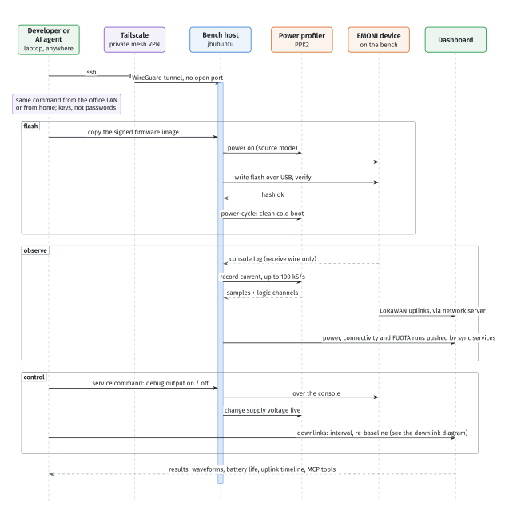</a> Sequence · remote flashing and measuring</td>
  </tr>
  <tr>
    <td align="center"><a href="fixing/README.md#2--automatic-re-baselining">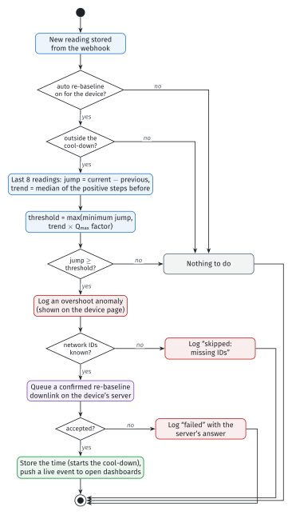</a> Activity · automatic re-baselining</td>
    <td align="center"><a href="fixing/README.md#the-whole-loop">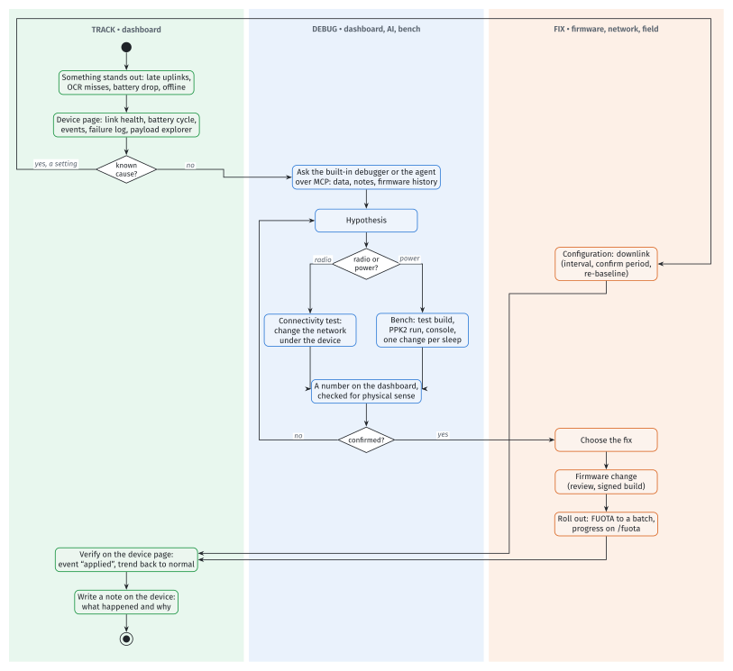</a> Activity · track, debug, fix, verify</td>
    <td align="center"><a href="debugging/README.md#the-ai-debugger">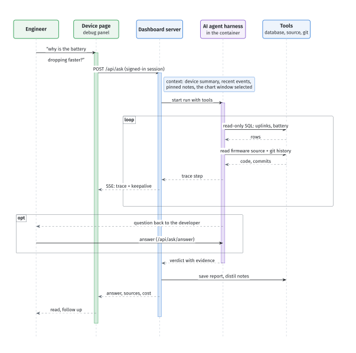</a> Sequence · the built-in AI debugger</td>
  </tr>
</table>

All eleven diagrams, with their TikZ sources: **[diagrams](diagrams/README.md)**.

---

## Sections

| | Section | What it shows |
|---|---|---|
|  | **[The device](device/README.md)** | what EMONI does, the drawings, and how one wake-up runs (activity diagram) |
| 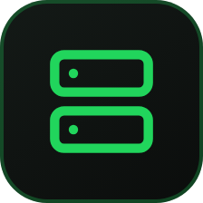 | **[The platform](platform/README.md)** | architecture, how an uplink becomes a live chart (sequence diagram), stack, deployment, security |
|  | **[Tracking](tracking/README.md)** | the fleet view and the device page: battery cycle and runtime, consumption, signal, KPIs |
|  | **[Debugging](debugging/README.md)** | failure log, link health, payload explorer, connectivity tests, power tests, the AI debugger |
|  | **[Fixing](fixing/README.md)** | downlinks, automatic re-baselining, FUOTA, and the whole track–debug–fix loop |
|  | **[The remote lab](remote-lab/README.md)** | flashing, powering and measuring bench devices from anywhere: Tailscale, the bench host, the PPK2 |
|  | **[AI in the loop](ai/README.md)** | how an AI agent drives the bench and the dashboard, and what it may and may not do |
|  | **[Case studies](case-studies/README.md)** | a 65× lower sleep current, battery artefacts told apart from real drain, a network outage on purpose |
| 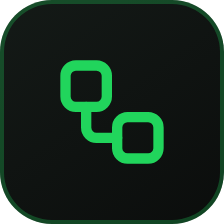 | **[Diagrams](diagrams/README.md)** | every sequence and activity diagram as LaTeX/TikZ source, PDF and SVG |

## What this shows about how I work

| Skill | Where to see it |
|---|---|
| **Building a product end to end**: hardware, firmware, cloud and tools, one person owning the whole chain | [Device](device/README.md), [platform](platform/README.md) |
| **Embedded and low-power debugging**: hypotheses, test builds, measurement before conclusion | [Case studies](case-studies/README.md#1--sleep-current-1840--28-µa), [remote lab](remote-lab/README.md) |
| **LoRaWAN in depth**: class A timing, confirmed uplinks, ADR, rejoin behaviour, downlink budgets, FUOTA | [Device](device/README.md), [connectivity tests](debugging/README.md#connectivity-tests), [FUOTA](fixing/README.md#firmware-over-the-air) |
| **Full-stack product engineering**: webhooks, data model, live UI, charts that answer real questions | [Platform](platform/README.md), [tracking](tracking/README.md) |
| **Test automation and hardware in the loop**: runners, sync services, reproducible runs | [Remote lab](remote-lab/README.md), [debugging](debugging/README.md#power-tests) |
| **AI tooling with guardrails**: MCP design, read-only by default, a human confirms every device change | [AI in the loop](ai/README.md) |
| **Security and operations**: no inbound ports, tokens and OAuth, secrets never leave the server, signed firmware | [Platform](platform/README.md#security) |
| **Documentation**: UML in LaTeX, public datasheet and technical reference | [Diagrams](diagrams/README.md) |

## At a glance

| | |
|---|---|
| **Device** | camera-based meter reader, on-device recognition, LoRaWAN EU868 Class A with OTAA, upload interval 1 min to 72 h, FUOTA with automatic rollback, ≈ 6 years on AA cells at the default 3 h interval (public datasheet) |
| **Platform** | Next.js 16 + React 19, Express + TypeScript, SQLite, server-sent events, Docker Compose, Cloudflare tunnel |
| **Bench** | Ubuntu bench host, Nordic PPK2 power profiler, console logging, Tailscale; power, connectivity and FUOTA runs pushed to the dashboard by three sync services |
| **AI** | MCP endpoint with 26 tools (OAuth or token), a built-in AI debugger that streams its trace and saves reports and notes |
| **Results** | deep sleep 197.5 → 28.3 µA on the bench (1840 µA on the first clean run), wake charge −20 %, every fix in firmware; network behaviour verified against the published rejoin rules |

## What is not in this repository

To respect my employer's IP and customer confidentiality, this repository contains **no** source code, schematics, part numbers, pin assignments, payload byte layouts, keys, internal addresses or customer data. Device names, identifiers and customer sites are masked or renamed in every screenshot. Where a product fact or drawing appears, it is already in EMONI's public documents.

---

© Huzaifa Ejaz. Screenshots, video and diagrams may not be reused without permission. EMONI is a product of ISIS IC GmbH; this is a personal portfolio. Device drawings and the city illustration: public EMONI datasheet. Icons: <a href="https://lucide.dev">Lucide</a> (ISC), as used in the dashboard.

