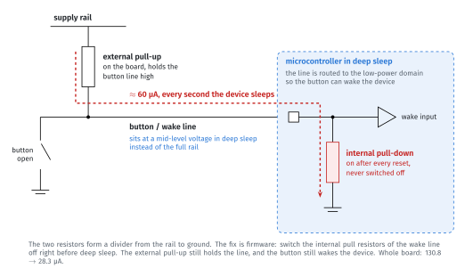
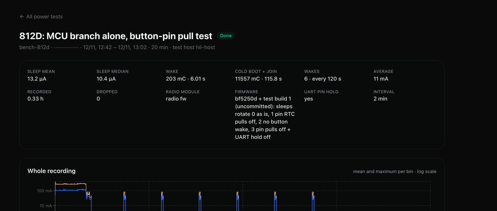
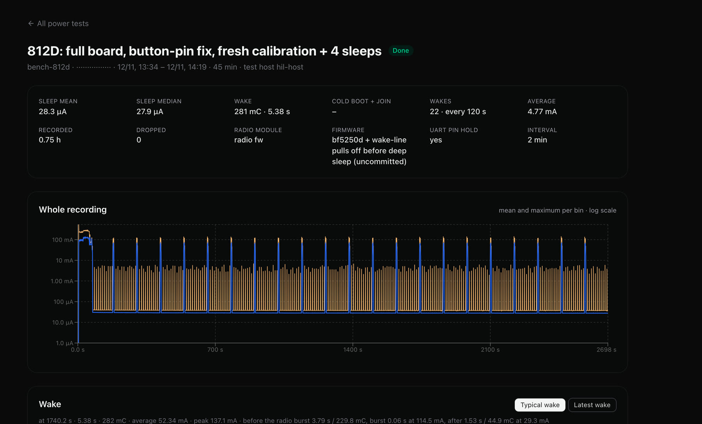

[← Overview](../README.md)

#  Case studies

Three problems, each found and fixed with the platform. Hardware specifics are generalised; the numbers are real.

---

## 1 · Sleep current: 1840 → 28 µA

**Symptom.** In the field, battery packs drained faster than the budget said. The datasheets of everything on the board add up to about **20 µA** in deep sleep. The first clean bench run measured **1840 µA**.

**Tools.** The [remote lab](../remote-lab/README.md) (power profiler, console, test builds with one change per sleep), the [power-test pages](../debugging/README.md#power-tests), and an [AI agent](../ai/README.md) driving the bench.

  

| Date | Cause | Fix | Sleep, whole board |
|---|---|---|---|
| 10 Nov | baseline (bench unit: radio module debug output on) | | 1840 µA |
| 10 Nov | the radio module's debug output kept it out of low power | off (field units never had it on) | 197.5 µA |
| 10 Nov | the motion sensor sampled continuously for wake-on-motion | sensor off before deep sleep; displacement still checked at every wake | 173.5 µA |
| 11 Nov | the sensor driver's init left the sensor's internal oscillator running | put the sensor in its real sleep mode as the last step before deep sleep | 130.8 µA |
| 12 Nov | the wake line's internal pull-down fought the board's pull-up | switch the wake line's internal pulls off before deep sleep | **28.3 µA** |

**How the last one was found.** Everything reachable from firmware was ruled out one by one (external RAM power, held pins, UART lines, peripherals), each with a test build and a recording. Then the branches were split. A supply sweep showed the same *power* at two input voltages, so the load sat behind the converter. With one part lifted, the microcontroller was measured alone: **64.4 µA**, against about 8 µA in its datasheet. A bare build that sleeps immediately measured **8.4 µA**, so the chip was fine and the firmware was leaving something on. A dump of every pin register right before sleep showed it:

  

The button pin doubles as the wake line. In deep sleep the microcontroller keeps an internal pull-down on it, which is on after every reset and which the wake setup never turns off. The board's pull-up holds the same line high. Together they form a divider that draws about 60 µA, all the time. An earlier board revision used a pin without this default; a redesign moved the button.

**Proof**, one change per sleep, in one recording:

  

**Result**, whole board:

  

| | Before | After |
|---|---|---|
| Deep sleep, field configuration | 197.5 µA | **28.3 µA** |
| Charge per normal wake | 318–327 mC | **242–256 mC** (camera at a lower clock until the frames are in, camera off before the radio exchange, a short sleep before the receive window, no success blink on battery) |
| Board revisions needed | | **none**: every fix was firmware |

The battery figures in the public datasheet (≈ 6 years at the default 3 h interval) were updated from these bench measurements.

**What went wrong on the way, and how it was caught:**

* A "pin hold" change looked like a 4× win on the first day. It had been measured with probe wires still on the radio module. Once they were off, the number never came back, and the result was withdrawn.
* In series with one branch, the profiler read 0.0 µA in sleep. A chip cannot sleep at zero: the shunt had put its rail below the rest of the board, and it drew its current through its pins.
* A 33 kΩ reference resistor at the start of a session checks the instrument itself (−1.7 %).

---

## 2 · Battery: artefacts or real drain?

**Symptom.** A field unit's battery chart had sudden jumps of up to +1.7 V, and a straight-line projection to the nominal empty voltage gave it 58–107 more days.

**Tools.** The [battery cycle](../tracking/README.md#battery-discharge-cycles) view, the [AI debugger](../debugging/README.md#the-ai-debugger), the device's notes.

**Finding.** The debugger went through the device's whole history. There were 38 single-sample jumps of +0.9 to +1.7 V, each followed straight away by a return to the previous level, so they were measurement artefacts. Only three jumps were real pack swaps: each followed a depleted reading and a gap of several hours. Measured on daily medians, the real drain was about 0.85 mV per uplink, the same as two packs earlier. Earlier packs had also collapsed within a day once they left their plateau, so the useful "empty" level is well above the nominal one.

**Result.** The report recommended a pack swap within about two weeks and a re-check of the trend after a few days. Since then the runtime estimate on the dashboard comes from the measured power profile, not from a straight line to the nominal empty voltage.

---

## 3 · A network outage, on purpose

**Question.** Does the device really do what the [published rules](../device/README.md#one-wake-up) say when the network misbehaves, and what does that cost?

**Tool.** A [connectivity test](../debugging/README.md#connectivity-tests) on a bench unit at a 2 min interval, with the self-hosted network server changed under it.

| Step | What happened | Numbers |
|---|---|---|
| Observe (15 min) | baseline | 7/7 readings, max gap 2 min |
| Session deleted (5 min) | the device noticed and rejoined | rejoined **2 min** after the reset |
| Downlinks blocked (20 min) | no ACKs: probes, then a rejoin attempt, then back-off | 2 of 10 expected readings, 4 probes, 5 missed checks, max gap 14.4 min |
| Downlinks back | recovery | recovery seen **5 min** after the restore |
| Fixed data rate (5 min) | slowest data rate forced | 2/2 readings, airtime 1.88 s |

**Result.** The firmware's network behaviour matches the documentation, the cost of an outage is known, and the dashboard can tell an outage from a device fault, because both now have a known signature.
