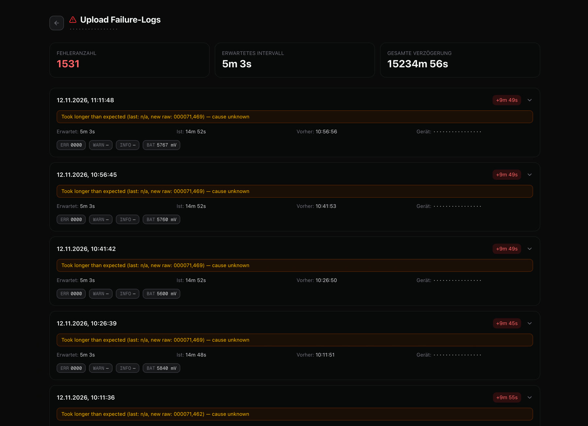
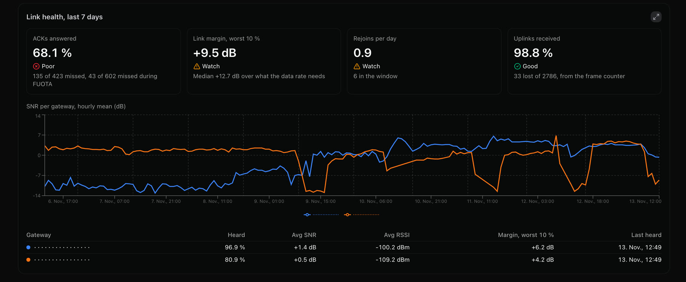
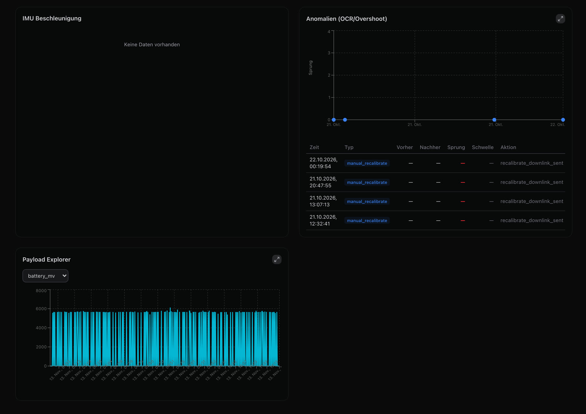
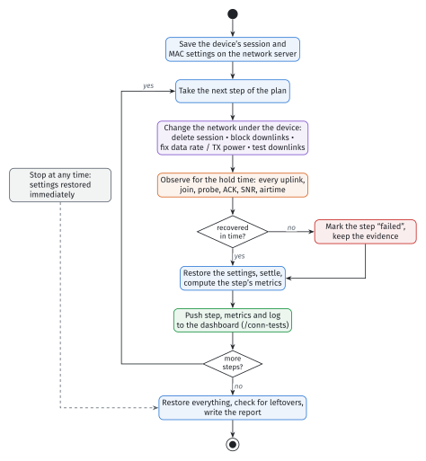
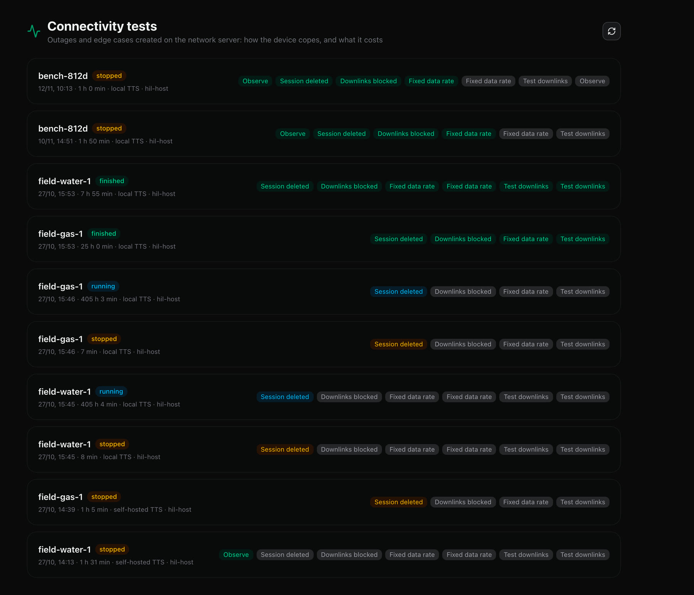
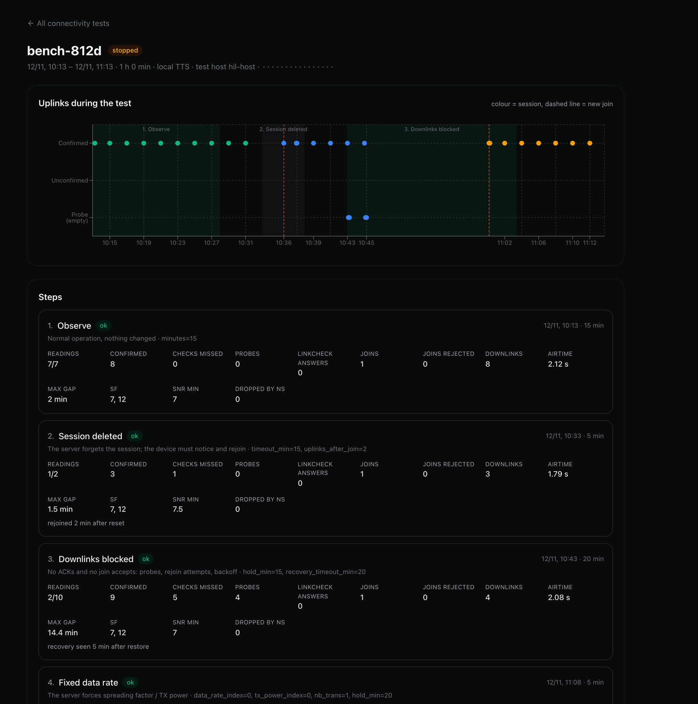
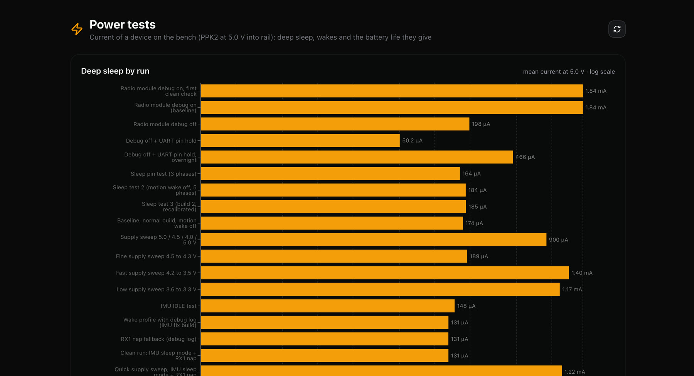
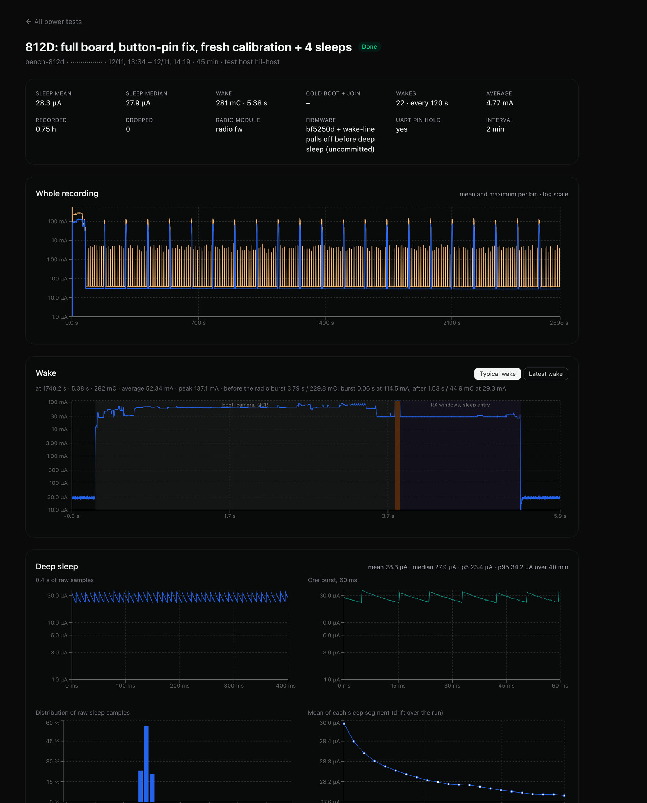
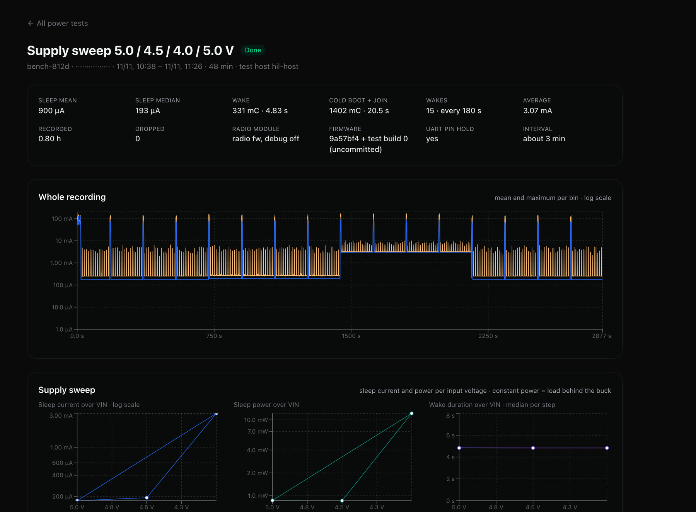
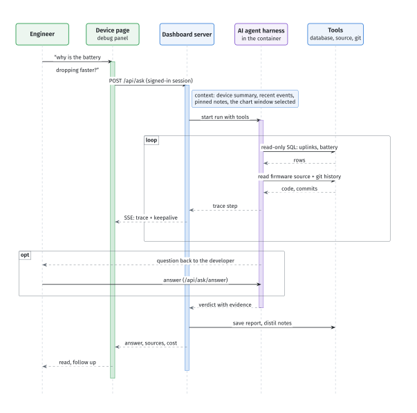

[← Overview](../README.md)

#  Debugging

Tracking says *that* something is wrong. These tools say *why*, from the desk, for a device that is in a basement somewhere.

## Failure log

  

Every uplink that arrived later than the device's interval allows becomes an entry: expected and actual gap, the previous uplink, the event codes and the battery of that uplink, and a **cause**. The cause is worked out from the data:

* recognition failed, or the raw value contains digits the device could not read,
* a digit roll-over artefact (a wheel caught between 9 and 0 on a mechanical counter),
* the value went down, or rose faster than the meter can physically allow,
* a firmware event code decoded into its meaning,
* otherwise *cause unknown*. In the screenshot the readings and codes are fine, so the next place to look is the radio side: this unit was in the middle of a firmware update over the air at the time, which the link-health panel below shows.

## Link health

  

Four numbers decide whether a radio problem is the network's or the device's:

| Tile | Meaning |
|---|---|
| **ACKs answered** | share of confirmed uplinks the network acknowledged. low ACKs with high delivery point at the downlink side (gateway duty cycle, FUOTA traffic) |
| **Link margin, worst 10 %** | how much SNR is left over what the data rate needs, on the bad days |
| **Rejoins per day** | how often the device gave up on its session ([wake cycle](../device/README.md#one-wake-up)) |
| **Uplinks received** | from the frame counter: what was sent against what arrived |

Below that, SNR per gateway per hour, and a table of every gateway that heard the device.

## Payload explorer and anomalies

  

* **Payload explorer**: any field the decoder produced, plotted over time. For a question nobody built a chart for yet.
* **Anomaly log**: every overshoot, manual and automatic re-baseline, with the jump, the threshold and what was done.
* **IMU**: tilt and movement, to tell a device that was knocked from one that misreads.

## Connectivity tests

The platform can only explain a late uplink if the firmware's network behaviour is known. Connectivity tests **change the network under a live device on purpose** and record how it copes and what it costs. A runner on the [bench host](../remote-lab/README.md) drives the self-hosted network server's API:

  

| Step | What the server does | What it verifies |
|---|---|---|
| Observe | nothing | the baseline: readings, confirmed uplinks, data rate, SNR, airtime |
| Session deleted | forgets the device's session | the device notices and rejoins, and how long that takes |
| Downlinks blocked | sends no ACKs and no join accepts | probes, rejoin attempts and back-off, and recovery once downlinks return |
| Fixed data rate | forces a spreading factor and TX power | delivery and airtime at the slowest and fastest data rates |
| Test downlinks | sends harmless unknown commands | the firmware ignores them safely |

  

  
  

Each uplink sits on a timeline coloured by session, with a dashed line at every new join. In the run shown, the device rejoined 2 minutes after its session was deleted and recovered 5 minutes after downlinks came back, as the published rules say it should. Settings are always restored, even when a run is stopped early.

## Power tests

  

Every recording from the [remote lab](../remote-lab/README.md) lands on `/power` by itself. A run page shows:

* the whole recording on a log scale, so a 100 mA wake and a 28 µA sleep fit on one chart,
* the **typical wake** split into phases (start-up and recognition, the radio burst, the receive windows), each with its time and charge,
* the **deep sleep**: raw samples, one converter burst, the distribution of the samples, and the drift of each sleep over the run,
* **battery life** at 5 min to 6 h intervals,
* every wake in a table, and the device's console log next to the samples.

  

A supply sweep shows each voltage step separately, with the sleep current, power and wake time per step:

  

## The AI debugger

On any device page, a **Debugger** button opens a panel where you ask a question in plain language. The server runs an AI agent next to the data:

  

From a saved report, shortened (a battery question on a field unit):

> **Verdict.** The selected window is the cleanest six hours this device has had in weeks: every uplink on time, no recognition errors. There is no elevated drain to explain, and the window is too short to measure drain anyway. The real findings are outside it: a cadence change that doubled the uplink load, and a recurring battery spike artefact.
>
> **Battery.** Single-sample jumps of +900 to +1700 mV occur 38 times in the history, each followed straight away by a return to the previous level. Only three jumps are real pack swaps, each preceded by a depleted reading and a multi-hour gap. Real drain, from daily medians: about 0.85 mV per uplink, the same as two packs ago.
>
> **Runtime.** Use the empirical floor, not the nominal empty voltage: earlier packs collapsed within a day once they left the plateau. Plan a pack swap within about two weeks and re-check the trend in 3–4 days.

The report separates artefacts from real pack swaps, works on daily medians and states what the selected window can show. More in [AI in the loop](../ai/README.md).
