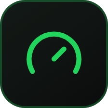
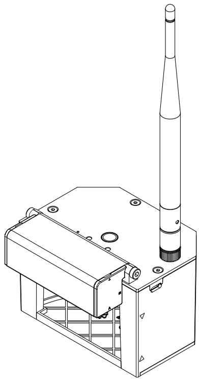
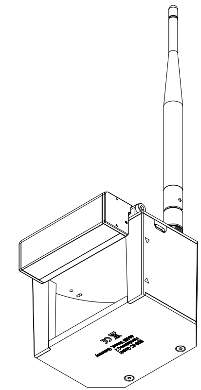
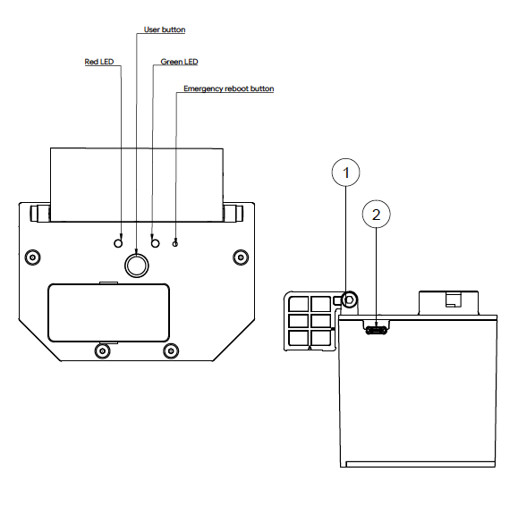
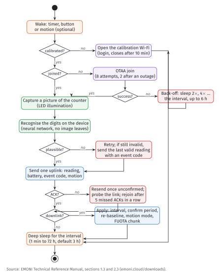

[← Overview](../README.md)

#  The device

I designed and built EMONI's LoRaWAN device: the hardware, the firmware, the on-device digit recognition, the LoRaWAN behaviour and the low-power design. I also wrote its public technical documentation.

The device's internals stay private. Every fact and drawing on this page is in EMONI's public documents: the [datasheet, user manual, technical reference manual and calibration guide](https://emoni.cloud/downloads/).

  
  &nbsp;&nbsp;
  

Drawings from the public EMONI datasheet.

## What it does

EMONI is mounted over the counter of an existing gas, water or electricity meter. It photographs the digits, recognises them **on the device** with a neural network, checks that the reading is plausible and sends the **absolute reading** over LoRaWAN. No pulse counting: a lost uplink or a battery change never leaves a gap in the total, and images never leave the device.

| | Public specification |
|---|---|
| Radio | LoRaWAN EU868, Class A, OTAA, confirmed uplinks, ADR |
| Interval | 1 min to 72 h, default 3 h, changeable by downlink |
| Power | 4 × AA lithium cells, or USB-C; ≈ 6 years at the default 3 h interval |
| Firmware updates | over LoRaWAN as small delta patches (FUOTA), automatic rollback |
| Security | secure boot, flash encryption, AES-128 LoRaWAN encryption, login-protected calibration menu |
| Calibration | once, on site, through a local Wi-Fi menu that closes after 10 minutes |
| Diagnostics in every uplink | battery voltage under load, an event code, motion data |

## On the meter

  

The device is mounted over the counter with a hinged holder and calibrated once on site through a local Wi-Fi menu: the reading area around the digits, the comma position, the meter type. After that it needs nobody. Two status LEDs and one button are the only user interface; everything else happens over LoRaWAN.

## One wake-up

Between wake-ups the device is in deep sleep. Each wake runs the same cycle, including how it handles a network that is down or a session the server has forgotten:

  

Three rules in this cycle matter a lot for the platform, because they decide what a "late" or "missing" uplink means:

* **Join back-off.** After a failed join the sleep time doubles (2×, 4× … the interval) up to 6 hours. During a network outage this limits the cost to a few short wakes a day.
* **Liveness.** A confirmed uplink carries a link check. Without an answer, the device probes the link, and after 5 confirmed uplinks in a row without an acknowledgement it rejoins. This also moves it to a new network server on its own.
* **Retries.** A reading that fails the plausibility check is retried. A failed confirmed uplink is resent once unconfirmed, so the reading still arrives.

These rules are why the platform can tell a radio problem from a firmware problem from a dead battery, and why the [connectivity tests](../debugging/README.md#connectivity-tests) exist: they break the network on purpose and check that the device does what this diagram says.

## What the device tells the platform

Each uplink carries the reading plus the information needed to diagnose the device remotely:

* **an event code**, the most important event of the cycle: recognition failed, value out of range, device moved, battery low, join or send failed, update installed or rolled back, downlink applied, and more. Events that cannot be sent in the cycle they happen in (a failed join, for example) are reported in the next uplink,
* **the battery voltage**, measured once per wake under load,
* **motion data**, so a device that was knocked or moved shows up.

The platform turns these into the device page, the failure log and the anomaly log. The event list and the frame format are in the public Technical Reference Manual. This portfolio does not repeat them.
