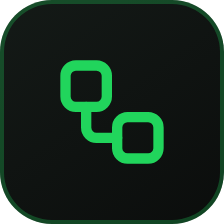

[← Overview](../README.md)

#  Diagrams

Every diagram in this portfolio is drawn in **LaTeX with TikZ**, from the `.tex` sources in this folder. One shared style file (`emoni-style.tex`) defines the colours, the lifeline, message and fragment styles of the sequence diagrams, and the action, decision and lane styles of the activity diagrams.

## Sequence diagrams

| Diagram | Shows | Used in |
|---|---|---|
| [`seq-uplink`](seq-uplink.svg) | a reading from the device through gateway, network server, webhook and storage to a live update in the browser, with the optional anomaly check | [Platform](../platform/README.md) |
| [`seq-downlink`](seq-downlink.svg) | changing a field device from the dashboard: confirmed downlink, class A timing, the device's confirmation | [Fixing](../fixing/README.md) |
| [`seq-fuota`](seq-fuota.svg) | a delta firmware update over LoRaWAN, one chunk per wake, verify, apply, result | [Fixing](../fixing/README.md) |
| [`seq-remote-bench`](seq-remote-bench.svg) | flashing, powering, measuring and controlling a bench device from anywhere, over Tailscale | [Remote lab](../remote-lab/README.md) |
| [`seq-ai-debugger`](seq-ai-debugger.svg) | a question on a device page answered by the built-in AI debugger | [Debugging](../debugging/README.md) |

## Activity diagrams

| Diagram | Shows | Used in |
|---|---|---|
| [`act-wake-cycle`](act-wake-cycle.svg) | one wake-up of the device, with join back-off, retries and rejoin rules (from the public Technical Reference Manual) | [Device](../device/README.md) |
| [`act-auto-recal`](act-auto-recal.svg) | the server's overshoot check and automatic re-baseline | [Fixing](../fixing/README.md) |
| [`act-conn-test`](act-conn-test.svg) | a connectivity test plan against a live device | [Debugging](../debugging/README.md) |
| [`act-debug-loop`](act-debug-loop.svg) | the track, debug, fix and verify loop, in three lanes | [Fixing](../fixing/README.md) |

## Other

| Diagram | Shows |
|---|---|
| [`architecture`](architecture.svg) | components of the whole system: field, network, platform, bench, clients |
| [`leak`](leak.svg) | the sleep-current leak of [case study 1](../case-studies/README.md), drawn generically |

## Build

```sh
tectonic -X compile seq-uplink.tex          # PDF (fonts: Fira Sans / Fira Mono, fetched by tectonic)
pdftocairo -svg seq-uplink.pdf seq-uplink.svg
```

Or all of them:

```sh
for f in seq-*.tex act-*.tex architecture.tex leak.tex; do
  tectonic -X compile "$f" && pdftocairo -svg "${f%.tex}.pdf" "${f%.tex}.svg"
done
```
