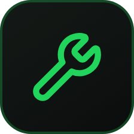
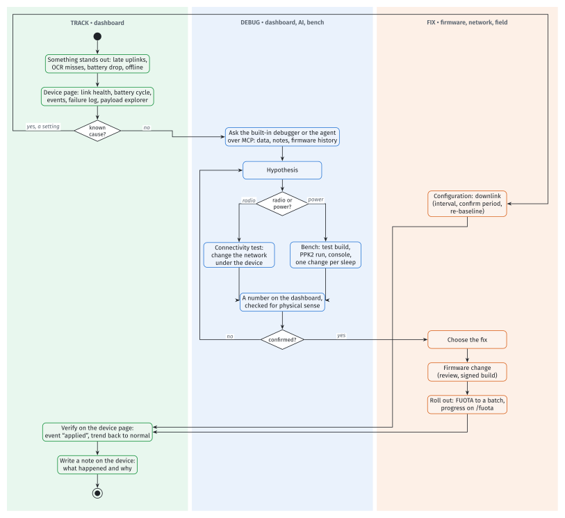
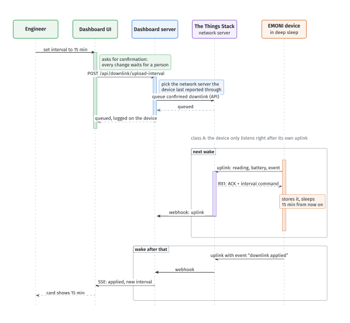
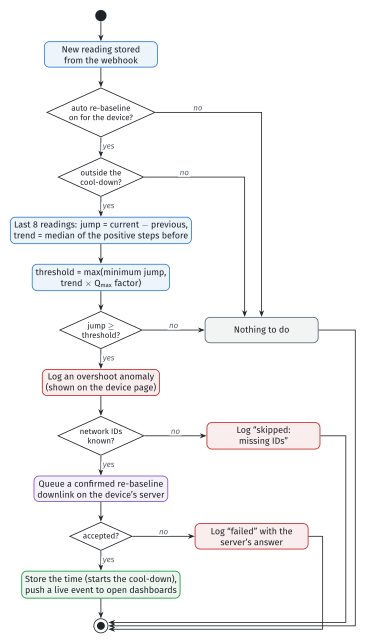
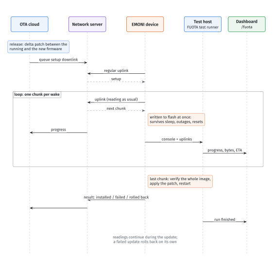
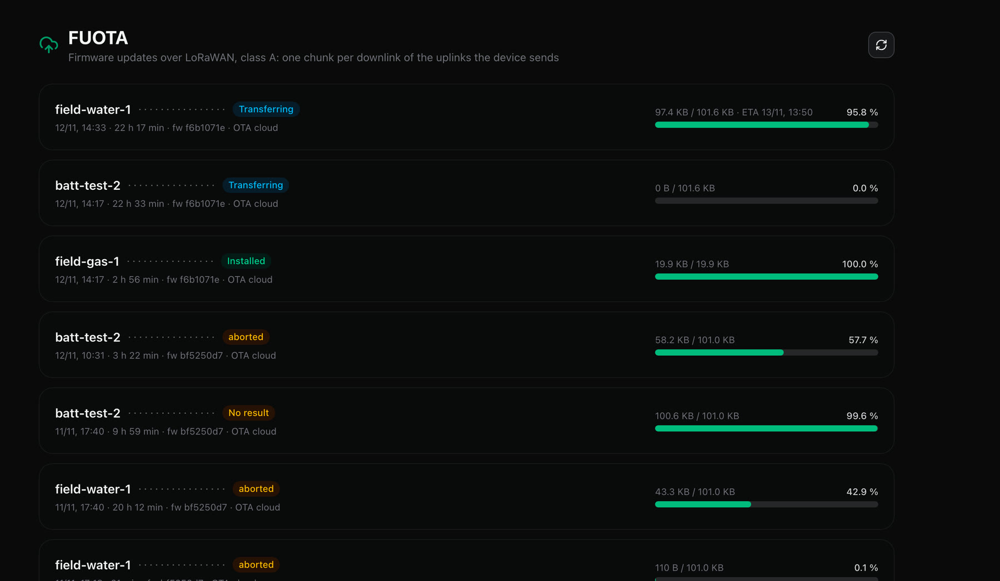
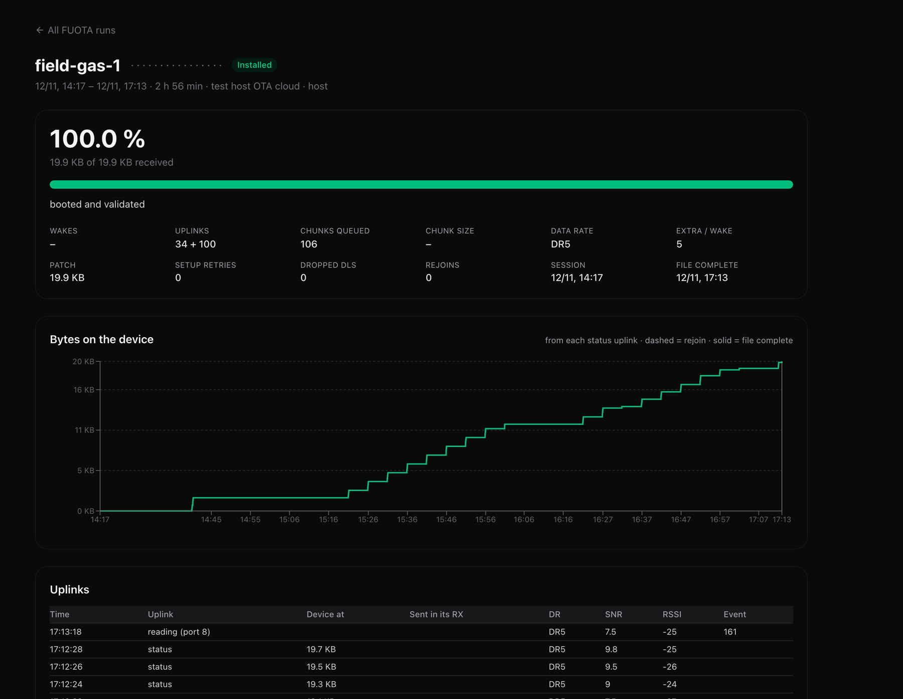

[← Overview](../README.md)

#  Fixing

A fix for a device in a basement has to travel the same way as its data: over LoRaWAN, in a few bytes, to a device that listens for about a second after each uplink. The platform gives three ways to fix things, from the smallest to the largest.

## The whole loop

  

Every fix ends the same way: **verify on the device page** (the device reports "downlink applied" or "update installed", and the trend returns to normal), and **write a note** on the device, so the next person or AI analysis knows what happened.

## 1 · Configuration by downlink

Interval, confirmed-uplink period, re-baseline of the stored reading and the motion sensor's mode can all be changed from the device page. The engineer confirms every change. The downlink waits on the network server until the device's next uplink:

  

* The downlink goes to the network server the device **last reported through**, so devices on different servers need no special handling.
* The device confirms it in its **next** uplink with a "downlink applied" event. The dashboard logs the queued command at once and shows the device's confirmation when it arrives, so "sent" and "applied" are never confused.

## 2 · Automatic re-baselining

A camera reading a mechanical counter can occasionally get a digit wrong and lock onto a value that is too high. The server checks every new reading and, if it jumps further than the meter can physically move, tells the device to re-baseline from its next recognition:

  

* The threshold adapts to the meter: the larger of a fixed minimum and the device's recent median step times a Qmax factor. A busy meter is allowed bigger steps than a quiet one.
* A **cool-down** stops it from firing again while the device is still settling.
* Everything is logged as an anomaly with the jump, the threshold and the outcome, including when it *could not* act (unknown network IDs, a rejected downlink).
* Threshold, factor and cool-down are settings per device.

## 3 · Firmware over the air

When the fix is in the firmware, it reaches the field as a **delta patch** (only the difference to the running firmware), in small downlinks, one per wake. This follows the public [Technical Reference Manual](https://emoni.cloud/downloads/):

  

The dashboard follows every update: progress and estimated completion on the device card, and a page per run with bytes on the device, uplinks, counters and the live log.

  
  

Readings continue during the update, each chunk is written to flash at once (so sleep, outages and resets don't lose progress), and a failed update rolls back on its own.

## Before anything ships

Firmware fixes are proven on the bench first, with the same dashboard: a test build, a recorded run, a number that has to make physical sense, then the release. The [case studies](../case-studies/README.md) show what that looks like.
