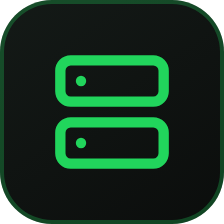
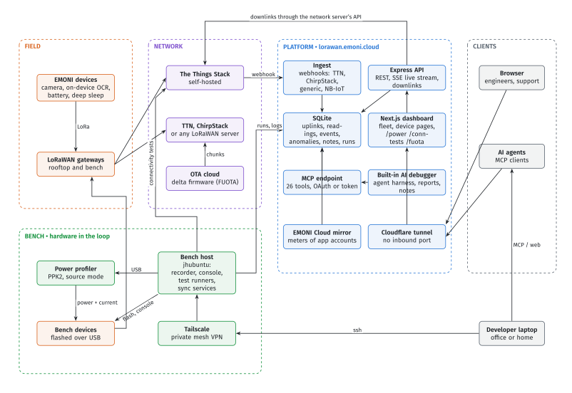
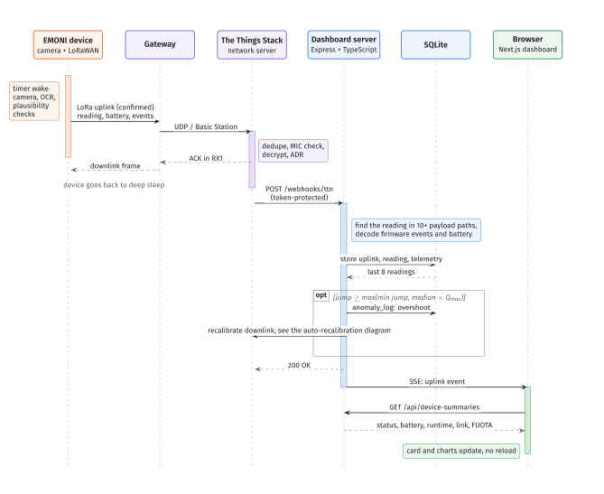

[← Overview](../README.md)

#  The platform · lorawan.emoni.cloud

A self-hosted web application that receives every uplink of every EMONI LoRaWAN device, keeps the full history, and gives engineers, the bench and AI agents one place to look. I designed and built it end to end: ingest, data model, API, UI, deployment, the test integrations and the AI endpoints.

  

## How an uplink becomes a live chart

  

1. The device wakes, reads the meter and sends one confirmed uplink. The network server de-duplicates it across gateways, checks and decrypts it, answers with the ACK in the first receive window, and the device goes back to sleep.
2. The network server posts the decoded uplink to the platform's webhook. Each provider has its own endpoint (The Things Stack, ChirpStack, a generic LoRaWAN format, NB-IoT), and every one is token-protected.
3. The server finds the reading even when integrations shape the payload differently (it checks more than ten known field paths), decodes the firmware's event code and battery, and stores the uplink, the reading and the device telemetry.
4. It checks the new reading against the device's recent trend. An implausible jump is logged as an anomaly and can trigger an automatic re-baseline downlink ([activity diagram](../fixing/README.md#automatic-re-baselining)).
5. A server-sent event tells every open dashboard about the uplink, and the device card and charts update without a reload. A polling fallback keeps working behind proxies that buffer event streams.

## Stack

| Layer | Choice | Why |
|---|---|---|
| UI | Next.js 16, React 19, Tailwind, Radix, Recharts, custom SVG heatmaps | dense, fast charts; dark and light themes; one page per device with everything on it |
| API | Express + TypeScript, about 90 routes | webhooks, REST, server-sent events, downlinks, test-run ingestion, a small versioned data API for integrations |
| Data | SQLite (embedded) | one file, no separate service, fast enough for years of uplinks; migrations in code |
| Live | server-sent events with keepalive + polling fallback | long streams survive the tunnel and proxies |
| Deploy | Docker multi-stage build, Docker Compose, Cloudflare tunnel | one command to deploy; the server needs no inbound port |
| AI | MCP endpoint (Streamable HTTP), AI agent harness for the built-in debugger | see [AI in the loop](../ai/README.md) |

## What the data model holds

Kept per device, for its whole life:

* **uplinks**, raw, with radio metadata per gateway (RSSI, SNR, data rate, frame counter),
* **readings** and **manual readings** (for meters read by hand, to bridge or check),
* **telemetry and events** decoded from each uplink,
* **anomalies** (overshoots, re-baselines, manual and automatic),
* **notes**: field knowledge the data cannot show ("moved to the bench", "debug output on"), pinned or per device,
* **analysis reports** saved by the AI debugger,
* **test runs** pushed by the bench: power, connectivity and FUOTA runs with their steps, metrics, logs and waveforms,
* meters mirrored from the **EMONI Cloud** app accounts, so LoRaWAN and cloud devices sit side by side.

## Multi-network

Devices may be on the self-hosted The Things Stack, the public The Things Network, or ChirpStack. The platform remembers which network server each device last reported through, and sends its downlinks there. Moving a device between servers needs no change on the platform.

## Security

| Concern | What the platform does |
|---|---|
| Ingest | every webhook needs a token |
| Exposure | no inbound port: the server publishes itself through an outbound Cloudflare tunnel |
| Writes from the bench | test runs are pushed with a token; credentials and key-shaped values are dropped before anything is stored |
| AI access | MCP over OAuth (dynamic client registration, a sign-in page) or personal tokens; only token hashes are stored; rate limits per client address |
| AI write limits | no downlinks, deletes or counter resets through MCP; every AI change leaves a note on the device |
| Built-in debugger | behind a sign-in; runs read-only queries; secrets columns refused |
| Secrets | network server API keys and cloud tokens stay on the server and are never returned |

## Deployment

The platform runs as a Docker Compose stack on an office server, next to the bench. Changes are merged and deployed with one command, and the Cloudflare tunnel publishes the dashboard and the MCP endpoint. The same compose files also run it locally, behind Caddy with HTTPS, or behind ngrok for a quick demo.
