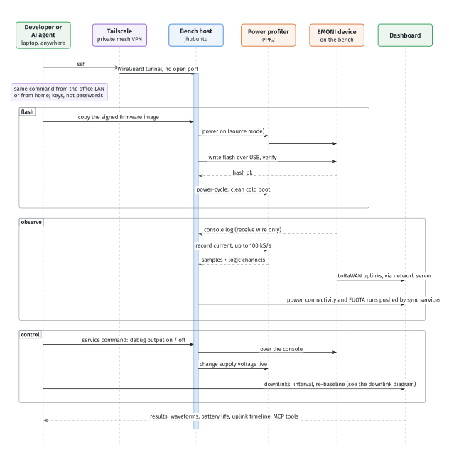

[← Overview](../README.md)

#  The remote lab

A bench I can use from anywhere. A device on the bench can be **flashed, powered, power-cycled, measured, put into debug mode and put through network tests** from my laptop, at the office or at home, and every result shows up on the dashboard. The same access lets an [AI agent](../ai/README.md) run the bench.

<p align="center">
  
</p>

## The pieces

| Piece | Role |
|---|---|
| **Bench host** (`jhubuntu`) | an Ubuntu PC next to the bench. Everything that has to stay plugged in is plugged in here: the power profiler, the device's USB port for flashing, a console adapter. It runs the recorder, the test runners and three sync services |
| **Tailscale** | a private WireGuard mesh VPN. My laptop reaches the bench host by name, from any network, with SSH keys. No port is opened on the office router |
| **Nordic PPK2** | a power profiler that **is** the device's battery: it supplies the board and records its current at up to 100 kS/s, with 8 logic channels for phase markers |
| **Console adapter** | the device's log, timestamped on the same clock as the current samples |
| **Gateway + self-hosted network server** | the bench device's uplinks take the real path to the dashboard, and the network can be changed under it for [connectivity tests](../debugging/README.md#connectivity-tests) |

## Flash, power, measure, control: from anywhere

<p align="center">
  
</p>

**Flash.** The firmware image is copied to the bench host and written to the device over USB with the vendor's flashing tool, then verified. The profiler powers the board, so the host can also power-cycle it for a clean cold boot. No one has to be at the bench.

**Measure.** One command starts a recording as a systemd unit on the host: profiler on, record for N seconds, profiler off. A lost SSH session or a closed laptop does not stop a run. The recorder:

* stores samples with the logic channels, and the console log on the same time base,
* counts the profiler's dropped samples (there should be none) and repairs its range-switch glitches so the charge adds up,
* finds every wake and reports the sleep floor (mean, median, p5, p95), charge and energy per wake, the time and charge in each phase, console markers (boot, join, uplink, sleep), and the battery life that follows.

**Control.**

* debug output on or off through a console service command, without reflashing,
* the supply voltage changed live, for sweeps of the battery's range,
* downlinks (interval, re-baseline) from the dashboard, the same as for a field device,
* network changes from the connectivity-test runner.

**See.** Three user services on the host (**power-sync**, **conntest-sync**, **fuota-sync**) push every power, connectivity and FUOTA run to the dashboard with its setup, metrics, waveforms and logs. Bench results sit next to the field data.

## Rules for a clean measurement

Most wrong numbers in this project came from the measurement setup. Each rule below comes from a run that broke it:

1. **Nothing else attached.** No battery, no USB, no debugger. A console adapter's transmit line can back-power the chip through its pin protection and add tens to hundreds of µA, so for sleep figures the console is wired **receive only**.
2. **No forgotten probe wires** on the board. One left on once produced a false 4× improvement, which was withdrawn.
3. **Measuring one branch in series can lie.** The shunt drop lowers that branch below its neighbours, and a sleeping chip then draws its current through its own pins from the board's pull-ups: it read 0.0 µA. Power the branch from the profiler instead.
4. **Debug output off.** Logging costs about 1.5 s and 100 mC per wake.
5. **Every run starts with a cold boot and a new join**, seen on the network server.
6. **Check the instrument.** A 33.0 kΩ reference on the profiler at 5.000 V reads 148.9 µA against 151.5 µA expected (−1.7 %), and 0.1 µA open. Absolute figures are good to ±2 %, run-to-run differences to 0.1–0.2 µA.

## One change per sleep

Test builds keep a counter that survives deep sleep and apply a different change in each sleep. One recording then compares several setups on the same board, at the same temperature, minutes apart:

```
microcontroller branch alone, one recording
sleep 1   as is                                71.6 µA
sleep 2   wake-line pulls off                  10.8 µA
sleep 3   no button wake                       10.5 µA
sleep 4   wake-line pulls off + UART hold off   8.6 µA
```

That is how the biggest leak in the [sleep-current case study](../case-studies/README.md#1--sleep-current-1840--28-µa) was proven in one 20-minute run.
