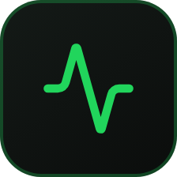
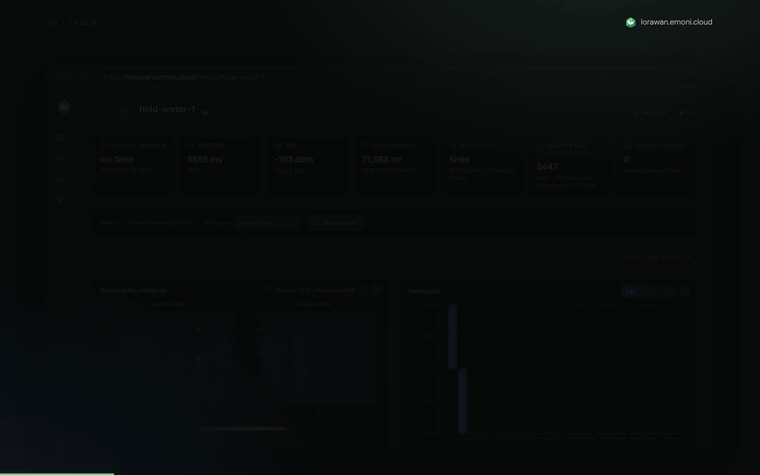
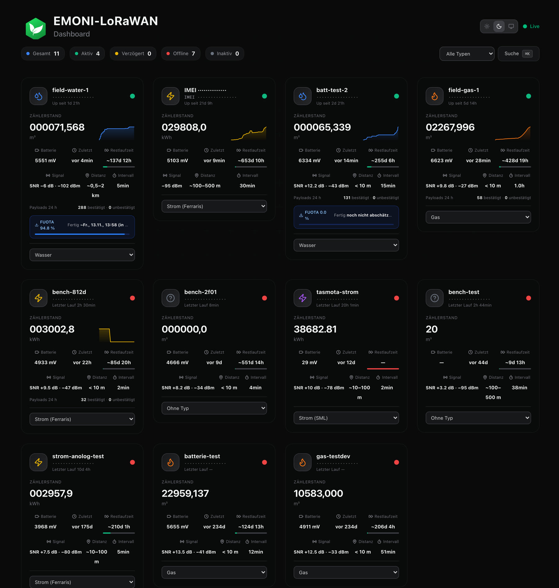
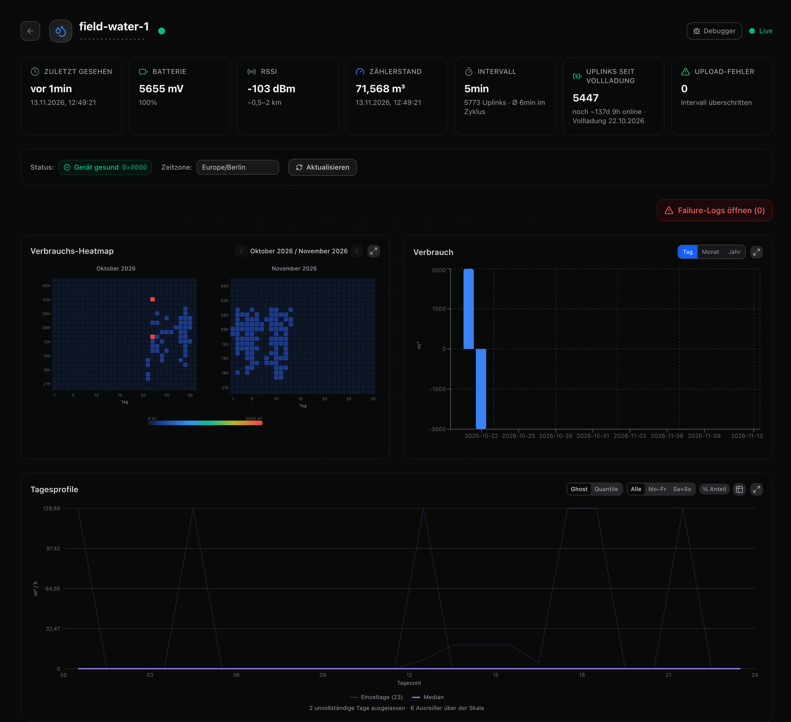
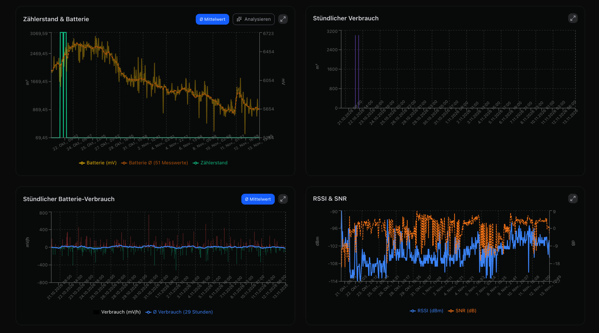
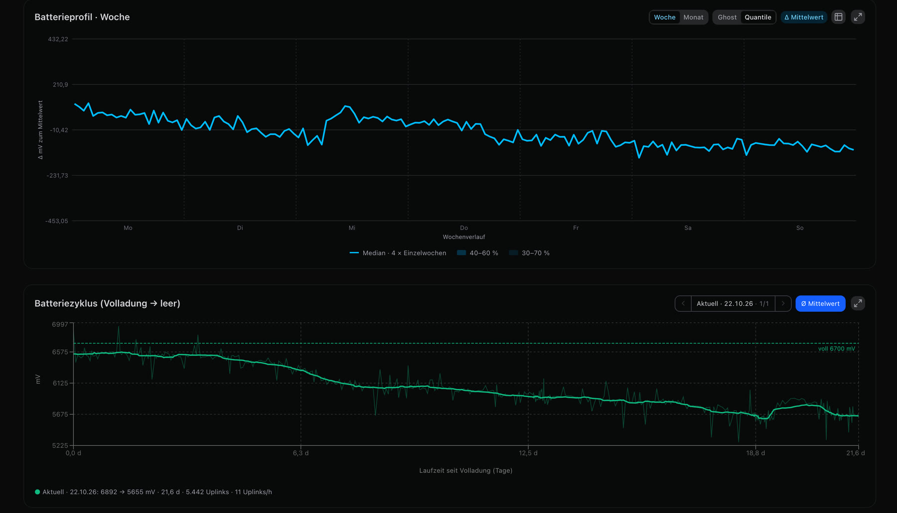

[← Overview](../README.md)

#  Tracking

The first job of the platform is to answer, at a glance: **is every device alive, and is it healthy?** And then for one device: **what has it been doing?**

Customer devices are renamed (`field-water-1`, `field-gas-1`) and every identifier is masked in these screenshots.

  

## The fleet

  

One card per device, updated live:

* **status**: online, late or offline, measured against the device's own interval, so a device on 3 h is not "late" after 20 minutes,
* **meter value** with a sparkline of recent consumption,
* **battery** voltage and the **runtime left**, from the measured power profile and the device's interval,
* **signal**: RSSI and SNR, and a distance estimate,
* **payloads in the last 24 h**, confirmed and unconfirmed,
* **FUOTA progress** with its estimated completion, while an update is running.

## One device

  

The device page puts everything about one device on one screen:

| Panel | Question it answers |
|---|---|
| KPI row | when was it last seen, battery, signal, reading, interval, uplinks since the last full charge, upload errors |
| Consumption heatmap | when is the meter used, hour by hour, across months |
| Consumption per day / month / year | how much, with manual readings merged in |
| Daily profiles | what a typical day looks like, outliers shown apart |
| Reading and battery | does the battery follow the expected curve while the reading rises |
| Hourly consumption and battery drain | which hours cost energy |
| RSSI and SNR | is the radio link getting worse |
| Link health | does the network answer: ACKs, link margin, rejoins, delivery, per gateway ([debugging](../debugging/README.md#link-health)) |
| Battery profile and battery cycle | how this pack compares with the last ones |
| IMU and anomalies | was the device moved, did a reading jump |
| Payload explorer | any decoded field over time ([debugging](../debugging/README.md#payload-explorer)) |

  

## Battery discharge cycles

A single battery voltage is hard to interpret. It sags under load, it depends on temperature, and some samples are measurement artefacts. The platform therefore tracks **discharge cycles**: each pack from full to empty, aligned on days since the last full charge. That shows whether this pack drains faster than the previous one, independent of when it was installed.

  

The runtime estimate on the card comes from the **measured** power profile of the device (deep-sleep current and charge per wake, from the [bench](../remote-lab/README.md)) and its interval. When a firmware fix changes the profile, the estimate follows.
